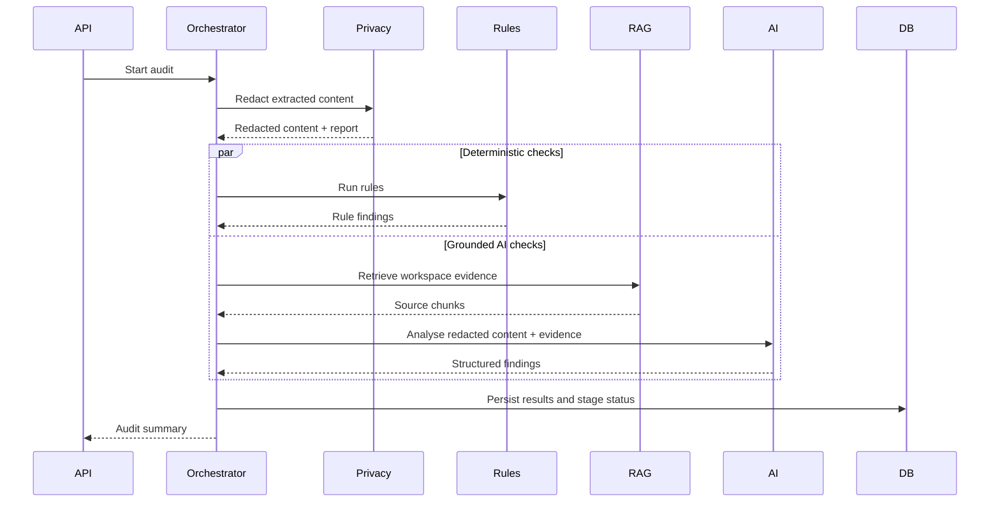

# Agent Roles and Orchestration
## VeriBrand Trace

## 1. Purpose
This document defines logical AI/software agent responsibilities. The Round 1 PDF specifies a hybrid deterministic + grounded RAG architecture; it does not specify autonomous multi-agent execution. The roles below are a proposed modular design and may be implemented as services/functions rather than independent LLM agents.

## 2. Components
### Orchestrator
- Creates an audit run and tracks stages.
- Dispatches deterministic checks, retrieval and AI analysis.
- Merges normalized findings.
- Handles timeouts, partial results and retries.
- Cannot approve content or publish it.

### Document Intake and Parsing
- Validates file metadata and supported formats.
- Extracts text and page/region locations.
- Produces parsing warnings and confidence metadata.
- Runs in a restricted processing environment.

### Privacy Redaction
- Detects configured PII and confidential terms.
- Masks content before external model transmission.
- Records redaction categories/counts, not unnecessary raw values.
- Supports review of redactions where policy permits.

### Deterministic Compliance Engine
- Checks banned/required terminology.
- Compares exact numeric claims against approved facts.
- Extracts colours and calculates configured colour-distance rules.
- Evaluates foreground/background contrast.
- Returns reproducible evidence and rule IDs.
- Does not use an LLM to decide deterministic outcomes.

### Brand Vault Retrieval
- Chunks and indexes guideline/fact content.
- Retrieves relevant passages with source IDs, versions and locations.
- Applies workspace filters to prevent cross-tenant retrieval.
- Rejects or flags missing evidence.

### Grounded Brand Analysis
- Evaluates tone, messaging and possible claim drift against retrieved context.
- Returns structured findings with citations to retrieved source IDs.
- Separates supported, contradicted and unverifiable claims.
- Treats retrieved documents as untrusted data, never as system instructions.

### Finding Normalizer
- Deduplicates related findings without losing source evidence.
- Applies severity mapping and common response schema.
- Preserves engine provenance and confidence/limitations.

## 3. Orchestration sequence

## 4. Structured output contract
Every finding should include:
- `category`, `severity`, `source_engine`
- `title`, `description`
- `location` (page, text offsets or image bounding box)
- `evidence[]` with source type, source ID and version
- `suggestion` (optional; never auto-applied)
- `status` and `limitations`

Validate all model responses using Pydantic. Reject malformed outputs and mark the AI stage failed rather than silently accepting unvalidated text.

## 5. Agent safety
- No agent can approve, publish or modify the original submission.
- Tool access follows least privilege.
- Workspace ID comes from authenticated server context, not model-generated arguments.
- Limit input size, output tokens, tool calls and execution time.
- Treat prompt injection inside uploaded files and retrieved documents as untrusted content.
- Keep a trace of model identifier, prompt version, retrieval references and validation result.
