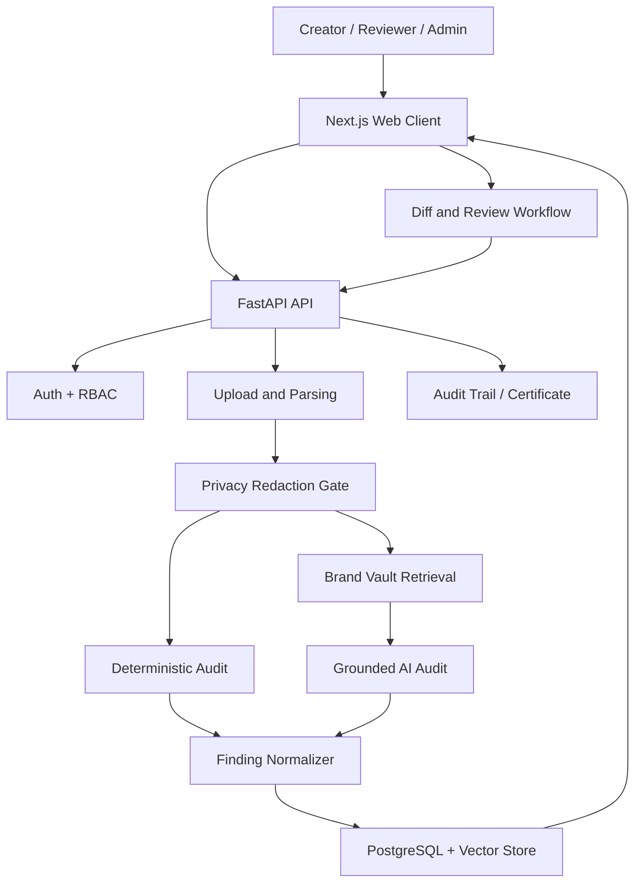

# System Architecture
## VeriBrand Trace

## 1. Source-plan architecture
The Round 1 PDF specifies:
- Frontend: Next.js 14, TypeScript, Tailwind CSS, TipTap.
- Backend API: Python 3.11, FastAPI, Pydantic v2.
- Deterministic engine: Python Regex, OpenCV, Pillow, EasyOCR and WCAG utilities.
- Grounded AI: Gemini 2.5 Flash with ChromaDB / pgvector retrieval.
- Database/RBAC: PostgreSQL (Supabase), SQLAlchemy and JWT authentication.

The source lists ChromaDB and pgvector as alternatives; choose one for the implementation rather than assuming both are required.

## 2. Proposed logical components
1. Web client: authentication UI, upload flow, audit results, diff editor and dashboards.
2. API layer: request validation, authentication, authorization and orchestration.
3. File service: upload validation, storage references, parsing and cleanup.
4. Privacy gate: PII/confidential-term detection and redaction.
5. Deterministic audit service: terminology, fact, colour and contrast checks.
6. Retrieval service: guideline/fact chunk retrieval with source metadata.
7. AI audit service: structured tone, messaging and claim-drift analysis.
8. Workflow service: audit states, revision transitions, exceptions and review.
9. Persistence layer: PostgreSQL records and vector index.
10. Observability: structured logs, metrics and security/audit events.

## 3. High-level data flow

## 4. Trust boundaries
- Browser to API: authenticated HTTPS requests.
- API to file storage: server-side credentials; never expose storage secrets.
- API to Gemini: send only redacted content and minimum required context.
- API to vector store/database: private server-side network/credentials.
- MCP clients to MCP server (if enabled): authenticated, scoped tool access; no unrestricted database access.

## 5. Processing sequence
1. Validate user, workspace access, file type, size and checksum.
2. Store original file in private storage and create an immutable submission revision.
3. Extract text/image features in an isolated processing task.
4. Apply configured privacy redaction.
5. Run deterministic checks and retrieve relevant Brand Vault evidence.
6. Call AI only with redacted content and retrieved context.
7. Validate AI output against a strict Pydantic schema.
8. Normalize findings, attach evidence references and persist results.
9. Return audit status and findings to the client.
10. Record every state-changing event.

## 6. Failure handling
- Deterministic engine failure: mark that check as failed; do not report it as passed.
- AI provider timeout: retain deterministic results and mark AI analysis incomplete.
- Vector retrieval failure: do not claim grounded verification; surface a service warning.
- Parsing failure: show a clear error and retain submission metadata.
- Partial audit: show which engines completed and which did not.
- Retry only idempotent processing stages; use job IDs and idempotency keys.

## 7. Deployment topology
Recommended initial topology: Next.js frontend, FastAPI backend, managed PostgreSQL, one selected vector store, private object storage and background worker. Exact hosting providers, queue technology and network topology remain deployment decisions.

## 8. Architecture decisions to record
Maintain ADRs for vector-store selection, file storage, background job mechanism, authentication provider, Gemini model/version, certificate signing and MCP enablement.
