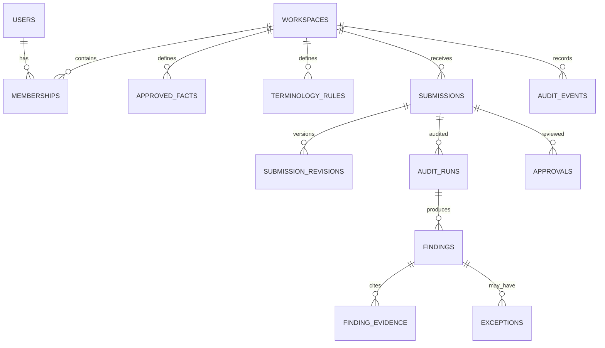

# Database Design
## VeriBrand Trace

**Database from source plan:** PostgreSQL (Supabase)  
**ORM from source plan:** SQLAlchemy  
**Vector store:** ChromaDB or pgvector (select one)

## 1. Design rules
- Use UUID primary keys.
- Store timestamps in UTC (`timestamptz`).
- Enforce workspace scoping in service queries and, where feasible, PostgreSQL Row Level Security.
- Preserve source versions and audit history; do not overwrite approved guideline/fact versions.
- Store uploaded file bytes in private object storage, not as large database blobs by default.
- Store secrets outside the database in a secret manager/environment configuration.

## 2. Proposed entities
| Table | Purpose | Key relationships |
|---|---|---|
| users | User identity/profile | Many memberships |
| workspaces | Brand tenant | Owns all brand data |
| memberships | User role in workspace | users + workspaces |
| guideline_documents | Imported guideline metadata | workspace |
| guideline_chunks | Parsed chunks and source locations | guideline_documents |
| approved_facts | Approved claim/fact registry | workspace |
| terminology_rules | Allowed/prohibited terms and replacements | workspace |
| visual_rules | Brand colours, logo and contrast rules | workspace |
| brand_assets | Logo and visual asset metadata | workspace |
| submissions | Uploaded content audit request | workspace + creator |
| submission_revisions | Immutable original/edited revisions | submissions |
| audit_runs | Processing run and engine status | submissions |
| findings | Normalized violations/observations | audit_runs |
| finding_evidence | Rule/fact/chunk evidence for a finding | findings |
| exceptions | Creator requests and reviewer decisions | findings + users |
| review_comments | Reviewer comments | submissions/revisions |
| approvals | Final review decisions | submissions/revisions |
| audit_events | Append-only security/workflow history | workspace + actor |
| compliance_certificates | Approval evidence metadata | approvals |
| integration_configs | Provider configuration references | workspace |

## 3. Important columns (proposed)
### workspaces
`id`, `name`, `slug`, `status`, `created_at`, `updated_at`.

### memberships
`id`, `workspace_id`, `user_id`, `role`, `created_at`, unique (`workspace_id`, `user_id`). Roles: `CREATOR`, `REVIEWER`, `GOVERNANCE_ADMIN`.

### approved_facts
`id`, `workspace_id`, `fact_key`, `statement`, `value_json`, `source_reference`, `status`, `version`, `valid_from`, `valid_until`, `created_by`, `created_at`.

### terminology_rules
`id`, `workspace_id`, `term`, `rule_type`, `replacement`, `case_sensitive`, `whole_word`, `severity`, `guideline_reference`, `active`.

### visual_rules
`id`, `workspace_id`, `rule_type`, `rule_config_json`, `severity`, `source_reference`, `active`, `version`.

### submissions
`id`, `workspace_id`, `created_by`, `title`, `input_type`, `status`, `created_at`, `updated_at`.

### submission_revisions
`id`, `submission_id`, `revision_number`, `storage_key`, `content_hash`, `extracted_text_reference`, `created_by`, `created_at`, unique (`submission_id`, `revision_number`).

### audit_runs
`id`, `submission_id`, `revision_id`, `status`, `deterministic_status`, `ai_status`, `model_identifier`, `rule_set_version`, `started_at`, `completed_at`, `error_code`.

### findings
`id`, `audit_run_id`, `category`, `severity`, `source_engine`, `title`, `description`, `location_json`, `evidence_json`, `suggestion_json`, `status`, `created_at`.

### finding_evidence
`id`, `finding_id`, `source_type`, `source_id`, `source_version`, `quote`, `location_json`.

### audit_events
`id`, `workspace_id`, `actor_user_id`, `entity_type`, `entity_id`, `action`, `metadata_json`, `previous_hash`, `event_hash`, `created_at`.

## 4. Relationships

## 5. Indexes and constraints
- Index every foreign key used in joins.
- Unique workspace slug.
- Unique membership (`workspace_id`, `user_id`).
- Unique revision number per submission.
- Index submissions by (`workspace_id`, `created_at`) and status.
- Index findings by (`audit_run_id`, severity, status).
- Index approved facts by (`workspace_id`, fact_key, status).
- Add CHECK constraints for enumerated statuses and positive revision numbers.
- Use soft deactivation/versioning for brand rules rather than destructive deletion.

## 6. Audit integrity
Audit events should be append-only at the application permission level. A hash chain can make tampering evident, but a hash chain alone does not prove authenticity if an attacker can rewrite the entire store. Consider signed periodic checkpoints and restricted database privileges for stronger evidence.

## 7. Open schema decisions
Finalize file metadata, retention policy, vector metadata format, tenant RLS policy, certificate signing and whether comments are anchored to character offsets or document block IDs before production migrations.
